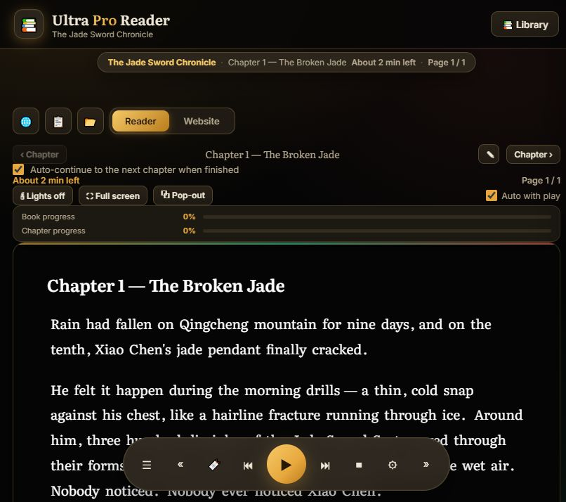
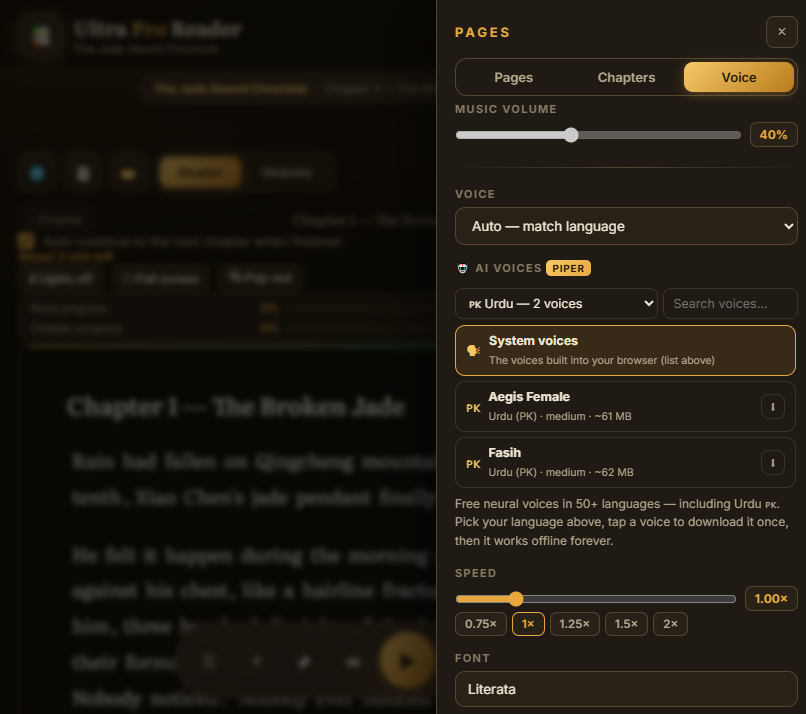

<div align="center">

# 📚 Ultra Pro Reader

**A read-aloud novel reader for Chrome & Edge — with free offline AI voices and a web-page reader built in.**

*Your books and the whole web, read aloud.* 📖🎧


</div>

---

Ultra Pro Reader started as a single-file read-aloud novel reader and is now a full **Manifest V3 browser extension**. Nothing from the original app was dropped — and it gained two superpowers: it can **read any website aloud**, and it runs **free offline neural AI voices (Piper)** directly on your device.

| 📖 Reading view |  |
| 🤖 Language-first Piper picker |  |

## ✨ Features

### 📖 The reader (everything from the original app)

| | |
|---|---|
| 🗂 **Library** | Import `.epub`, `.pdf`, `.txt`, `.md`, `.html` — or paste text. Smart chapter splitting, rename, search & sort. Everything is stored locally (unlimited storage) and kept until **you** clear it — **🗑 Clear stored books** in the library does exactly that. |
| 🔊 **Read aloud** | Karaoke word highlighting, click-to-read, sentence skip, auto-continue, custom pronunciation rules & skip lists. |
| 📚 **Web-novel sources** | Pick a source (NovelFull, AllNovelFull), search, and import a chapter range (up to 150 per batch) straight into your library — long novels load their chapter lists lazily. |
| 🀄 **Smart translation** | Gender-aware translation (他/她 fix) and custom character corrections for CJK novels. |
| 🎬 **Cinema modes** | 🕯 Lights off · ⛶ Full screen · ⧉ Pop-out window · Auto with play. The header tucks away and non-narrated paragraphs dim so your eyes follow the voice. |
| 📏 **Reading layout** | Text column capped at an optimal 72-character measure — no more lines stretching edge-to-edge. |
| 🌧 **Background ambience** | **87 bundled recordings** organized by genre — Nature/Weather (rain, soft rain, blizzards, crickets), Animals & Wild (owls, wolves, birdsong, jungle), Ambient soundscapes, and Cinematic moods (action, fantasy, mystery, sci-fi, thriller). Compressed to ~64 kbps (~69 MB total); mixes under the narration and follows play/pause. |
| 🧭 **The Orb** | Edge-docking floating menu: tap = play/pause, long-press = menu, drag = reposition. |
| 📊 **Always-on HUD** | Title · chapter · time left · page, plus BOOK % and CHAPTER % progress bars. |
| 💾 **Backup / Restore** | Export your whole library to a `.json` file — **complete book text**, bookmarks, progress and settings. Old heading-only backups restore fine; the text is refilled from local storage where available. |

### 🦾 Extension superpowers

| | |
|---|---|
| 🤖 **183 AI voices in 50+ languages (Piper)** | Pick your language from the dropdown — English, **Urdu 🇵🇰**, Hindi, Arabic, Bengali, Japanese, Korean, Hebrew, Chinese, Thai, Telugu, and many more. Tap a voice to download it once (~20–110 MB), then it works **fully offline**. The engine + model warm up as soon as the reader opens (no lag on the first sentence), and two batches are always synthesized ahead so reading never stalls between sentences. Search box, country flags, quality & exact sizes shown; 🗑 frees downloaded models. |
| 🌐 **Read any website aloud** | Toolbar button or right-click → the article is extracted, added to your library, and read aloud. Select a paragraph → right-click to read just that. |
| 🕷 **Smooth extraction engine** | A port of the open-source *Read Aloud* extension's parser: DOM block walking + statistical boilerplate trimming, with hints for novel sites (wtr-lab, Royal Road, Wattpad, Webnovel, AO3, FanFiction, ScribbleHub, …). |
| 📑 **wtr-lab & JS-only sites** | Sites that hide chapter text behind JavaScript are read through a live-tab grab: a hidden tab opens briefly, waits for the reader to hydrate, extracts the chapter, and closes. Next-chapter links are detected, so ⏭ auto-continue keeps reading the series. |
| 📚 **EPUB collection sites** | Pages hosting a shelf of `.epub` files are detected automatically — the files are downloaded and imported as real books with full chapters. Pasting a direct `.epub` URL works too. |
| 🖱 **Right-click menu** | *Read this page aloud* · *Read the selected text aloud* · *Add this page to my library* · *Open Ultra Pro Reader*. |

## 🚀 Install

### Load unpacked (Chrome & Edge — same steps)

1. Download / clone this repository, or unzip `Ultra-Reader-Extension.zip`.
2. Open the extensions page:
   - Chrome: `chrome://extensions`
   - Edge: `edge://extensions`
3. Turn on **Developer mode** (toggle, usually top-right).
4. Click **Load unpacked** and select the `Ultra-Reader-Extension` folder.
5. Pin **Ultra Pro Reader** to the toolbar. Done 🎉

> **Updating:** replace the folder contents with the new version, then press the ↻ refresh icon on the extension card.
>
> **Moved the folder?** If you see *"An unknown error occurred when fetching the script"*, the loaded path is stale. **Remove** the card and **Load unpacked** again from the new location.

### First-time tips

- Open the reader, import a book, and press ▶.
- For an AI voice: ⚙ **Voice** → 🤖 **AI voices (Piper)** → choose your language → tap a voice. The first download is one-time and cached for offline use.

## 🧭 Everyday use

| I want to… | Do this |
|---|---|
| Read a file (epub/pdf/txt/md/html) | Reader → 📂 → pick the file |
| Read a web novel / article | Toolbar 🔊 *Read this page aloud*, or right-click → 📖 — or paste the chapter URL in the reader (wtr-lab works) |
| Read just a paragraph | Select the text → right-click → 🔊 *Read the selected text aloud* |
| Use an AI voice | Reader → ⚙ Voice → 🤖 **AI voices (Piper)** → pick your language → tap a voice |
| Add rain / ambience under narration | Reader → ⚙ → **Background music** → pick a mood or recording |
| Go back to system voices | Voice drawer → **System voices** chip |
| Read in the dark | 🕯 / ⛶ / ⧉ above the book (or Auto with play) |
| Add a web novel without opening the site first | Library → 📚 **Sources** (or the 📚 button above the book) → search → pick novel → choose chapters → Import |
| Move the library to a new PC | Library → 💾 Backup → 📥 Restore on the other PC |
| Free up storage / start fresh | Library → 🗑 **Clear stored books** (back up first — it deletes everything) |

## 🔒 Privacy

- **100% local.** No accounts, no servers, no analytics, no cloud sync.
- Books, progress, and settings never leave your device (IndexedDB + browser storage, with the `unlimitedStorage` permission so large libraries are never evicted).
- AI voice models are fetched once from the free [`piper-voices`](https://huggingface.co/rhasspy/piper-voices) library on Hugging Face and cached in the browser's private OPFS storage.

## 🧰 Tech notes

- **Manifest V3** service worker + a fully bundled reader page — **zero remote scripts** (pdf.js, the Piper WASM engine and the ONNX runtime all ship inside the folder, as MV3 requires).
- **Piper** is the open-source neural TTS engine; audio is synthesized locally on your CPU via WebAssembly.
- Storage: IndexedDB for book text, `chrome.storage`/localStorage for settings and progress.
- The Piper voices and web-page reader are **additions** — the reader still works exactly like the original app with system voices.

### Project structure

```
Ultra-Reader-Extension/
├── manifest.json              # MV3 manifest (v1.2.0)
├── background.js              # Service worker: extraction engine + tab grab + message relay
├── reader.html / js/
│   ├── reader.js              # The full reader app (library, playback, HUD, cinema, …)
│   └── piper.js               # Piper bridge: 183-voice catalogue + OPFS caching
├── vendor/
│   ├── piper/                 # Piper TTS (WASM) + voice catalogue
│   ├── ort/                   # ONNX Runtime Web
│   ├── piper-wasm/            # Phonemize data
│   └── …                      # pdf.js etc.
├── audio/                     # 87 ambience tracks (~64 kbps MP3)
└── README.md
```

## ❓ FAQ

**Do the AI voices need internet?**
Only the first time you pick a voice. Afterwards they run offline on your CPU.

**Is my data uploaded anywhere?**
No. No servers, no accounts, no analytics.

**Why did the first sentence take a few seconds?**
The engine + voice model now warm up as soon as the reader opens, so the first sentence starts fast. Sentences are pre-generated two batches ahead in the background so the following pages flow smoothly.

**A voice failed to download.**
First downloads need a connection and can be 20–110 MB. Check your network and tap the voice again — downloads resume in place.

**The extension shows "An unknown error occurred when fetching the script".**
The extension folder was moved or renamed after loading. Remove the card on the extensions page and **Load unpacked** again from the current folder.

## 🙏 Credits

- [Piper](https://github.com/rhasspy/piper) — open-source neural TTS (MIT) and the [`piper-voices`](https://huggingface.co/rhasspy/piper-voices) model library
- [Read Aloud](https://github.com/ken107/read-aloud) (by Hai Phan, MIT) — article extraction engine this extension's web reader is ported from
- [pdf.js](https://mozilla.github.io/pdf.js/) — PDF rendering
- [ONNX Runtime Web](https://onnxruntime.ai/) — local model inference

## 📄 License

[MIT](LICENSE) © 2026 z33shan33khan

---

<div align="center">

*Ultra Pro Reader — your books and the whole web, read aloud.* 📖🎧

</div>
